# Arquitectura G1 Marketplace — corte H4 del 28/10/2026

Responsable: Jim Segovia · Revisor: Diego Espinoza · Seguimiento: [BE #202](https://github.com/Taller-SW-Web/G1-Marketplace-Backend/issues/202).

Este documento describe la composición del código G1 en las ramas indicadas y separa lo observado en el despliegue de lo que sigue pendiente. Una ruta implementada, un adaptador MOCK o un proceso saludable no acreditan por sí solos la función completa.

## Cortes y fuentes

| Fuente | Revisión consultada | Uso |
| --- | --- | --- |
| [Backend G1](https://github.com/Taller-SW-Web/G1-Marketplace-Backend/tree/cd0b93a1949aa7b08ecc3495dc5a1224d51dbe14) | `develop` `cd0b93a` | Composición NestJS, módulos, adaptadores y configuración. |
| [Frontend G1](https://github.com/Taller-SW-Web/G1-Marketplace-Frontend/tree/e448a20115468c299c68a516d22c6a2c2731aa88) | `develop` `e448a20` | Next.js, páginas y Route Handlers. |
| [SPECS G1](https://github.com/Taller-SW-Web/G1-Marketplace-SPECS/tree/46005a488bef751ba76d9496193eb2ddbb04453e) | `main` `46005a4` | [S02](https://github.com/Taller-SW-Web/G1-Marketplace-SPECS/blob/46005a488bef751ba76d9496193eb2ddbb04453e/plan/iteraciones/S02-semanas-09-11.md), [alcance H4](https://github.com/Taller-SW-Web/G1-Marketplace-SPECS/blob/46005a488bef751ba76d9496193eb2ddbb04453e/plan/ALCANCE-H4-PRODUCTOS-SEGURIDAD.md) y [transversales](https://github.com/Taller-SW-Web/G1-Marketplace-SPECS/blob/46005a488bef751ba76d9496193eb2ddbb04453e/plan/seguimiento/TRANSVERSALES.md). |

Los SHA son de ramas, no identificadores certificados de un deployment. Andrés administra Render/Vercel; registrar el deployment y SHA efectivos antes de usar este diagrama como evidencia de una versión publicada. Los documentos [integración G7](INTEGRACION-G7-H4.md) y [catálogo](CATALOGO-S1.md) contienen cortes anteriores y deben leerse con sus fechas.

## Contexto y límites de confianza

```mermaid
flowchart LR
    U[Cliente navegador] -->|HTTPS| W[Web G1 Next.js<br/>Vercel]
    W -->|Route Handlers<br/>HTTPS| B[BFF G1 NestJS<br/>Render]
    B -->|sesión opaca y datos G1| DB[(PostgreSQL G1<br/>Render)]
    B -->|login, MFA, refresh, logout<br/>registro y contraseña según capacidad| G7[Seguridad G7]
    B -.->|catálogo REAL si se homologa<br/>y configura| G6[Productos G6]
    B -.->|checkout / ventas<br/>integración pendiente| G5[Ventas y otros proveedores]
    G7 -->|correo de recuperación<br/>abierto en SPA G7| U
```

Las líneas continuas indican componentes o llamadas de cuenta que cuentan con implementación G1 y pruebas parciales reales; no implican que todos sus casos de aceptación estén cerrados. Las líneas discontinuas indican fronteras cuya integración completa no está acreditada. El retorno desde la SPA G7 a Marketplace sigue pendiente de implementación y prueba. El correo de recuperación observado apunta a la SPA G7; la decisión del PO del 26/10 asigna allí la interfaz de recuperación y restablecimiento. Las SPECS G1 aún requieren alineación con esa decisión.

En una consulta pública de sólo lectura del 28/10, cerca de las 00:00 Lima, `/ready` del BFF respondió 200 y las capacidades del BFF y la web respondieron `login:true`, `registro:false`, `recuperacion:true`. La primera consulta a `/live` agotó el tiempo desde este equipo; las siguientes lecturas no determinan su causa. No se usaron cuentas ni enlaces de correo en esta comprobación.

El navegador habla con la web G1. Los [Route Handlers](https://github.com/Taller-SW-Web/G1-Marketplace-Frontend/tree/e448a20115468c299c68a516d22c6a2c2731aa88/src/app/api) llevan las solicitudes al BFF; la web no recibe claves de servicio de G6/G7. [AppModule](https://github.com/Taller-SW-Web/G1-Marketplace-Backend/blob/cd0b93a1949aa7b08ecc3495dc5a1224d51dbe14/src/app.module.ts) compone Auth, Cart, Catalog, ProductDetail, Wishlist, Checkout, Orders, Health y Prisma en un servidor NestJS. [Render](https://github.com/Taller-SW-Web/G1-Marketplace-Backend/blob/cd0b93a1949aa7b08ecc3495dc5a1224d51dbe14/render.yaml) declara el servicio web, PostgreSQL y `/live` como health check. `/ready` comprueba la base, pero no prueba proveedores externos.

La sesión G1 usa cookie opaca HttpOnly y almacena identificador derivado y contenido cifrado en PostgreSQL; el BFF obtiene y renueva credenciales G7 sin entregarlas a JavaScript del navegador. [Guía G7](INTEGRACION-G7-H4.md) y [SessionStore](https://github.com/Taller-SW-Web/G1-Marketplace-Backend/blob/cd0b93a1949aa7b08ecc3495dc5a1224d51dbe14/src/auth/session.store.ts) describen la frontera. La comprobación JWKS/issuer del [guard](https://github.com/Taller-SW-Web/G1-Marketplace-Backend/blob/cd0b93a1949aa7b08ecc3495dc5a1224d51dbe14/src/security/auth.guard.ts) es distinta de la introspección de revocación, que permanece condicionada por configuración y homologación G7. No inferir revocación remota por un logout local.

## Estado funcional por frontera

| Frontera | Implementado en G1 | Evidencia y límite al corte |
| --- | --- | --- |
| G1 web ↔ BFF ↔ G7, F-002/F-003 | Login, desafío MFA, sesión, refresh y logout; [módulo Auth](https://github.com/Taller-SW-Web/G1-Marketplace-Backend/blob/cd0b93a1949aa7b08ecc3495dc5a1224d51dbe14/src/auth/auth.module.ts). | Pruebas HTTP reales A/B positivas y algunos negativos en [BE #29](https://github.com/Taller-SW-Web/G1-Marketplace-Backend/issues/29), [#30](https://github.com/Taller-SW-Web/G1-Marketplace-Backend/issues/30), [#33](https://github.com/Taller-SW-Web/G1-Marketplace-Backend/issues/33) y [#34](https://github.com/Taller-SW-Web/G1-Marketplace-Backend/issues/34). Falta recorrido UI, retest de intermitencia, cobertura de seguridad y revisión independiente. |
| Registro/verificación, F-001 | [AccountController](https://github.com/Taller-SW-Web/G1-Marketplace-Backend/blob/cd0b93a1949aa7b08ecc3495dc5a1224d51dbe14/src/auth/account.controller.ts) y UI preparados. | Capacidad pública `registro:false` en el último corte observado; despliegue G7 y prueba de enlaces/retorno pendientes. [BE #25](https://github.com/Taller-SW-Web/G1-Marketplace-Backend/issues/25). |
| Recuperación/restablecimiento, F-004/F-005 | Adaptador BFF y web G1 preparados; capacidad `recuperacion:true` observada el 26/10. | Por API web G1 se observó 202 y correo recibido, luego 204, login nuevo y rechazo de contraseña anterior/token reutilizado. El correo abrió SPA G7; faltan retorno a G1, UI manual, enlace vencido, seguridad y revisión. [BE #37](https://github.com/Taller-SW-Web/G1-Marketplace-Backend/issues/37), [#41](https://github.com/Taller-SW-Web/G1-Marketplace-Backend/issues/41). |
| Catálogo G1 ↔ G6 | [CatalogModule](https://github.com/Taller-SW-Web/G1-Marketplace-Backend/blob/cd0b93a1949aa7b08ecc3495dc5a1224d51dbe14/src/catalog/catalog.module.ts) y [adaptador real condicionado](https://github.com/Taller-SW-Web/G1-Marketplace-Backend/blob/cd0b93a1949aa7b08ecc3495dc5a1224d51dbe14/src/catalog/provider.ts); contrato candidato G6 `0.6.0-rc.1`, SHA `f64bfe9`. | La última consulta pública de catálogo dio 503 `CATALOG_UNAVAILABLE` con diagnóstico interno de configuración ausente. No sustituir por MOCK en producción. [Guía de catálogo](CATALOGO-S1.md). |
| Favoritos/Carrito ↔ identidad/catálogo | Persistencia y lectura de favoritos en G1; [WishlistModule](https://github.com/Taller-SW-Web/G1-Marketplace-Backend/blob/cd0b93a1949aa7b08ecc3495dc5a1224d51dbe14/src/wishlist/wishlist.module.ts) aún inyecta elegibilidad/proyección sandbox. | Lista vacía 200 y anónimo 401 observados; sin productos reales distintos de A/B no se ha probado aislamiento completo ni proyección G6. |
| Checkout/Orders ↔ proveedores externos | Estructura y pruebas locales; [gateway](https://github.com/Taller-SW-Web/G1-Marketplace-Backend/blob/cd0b93a1949aa7b08ecc3495dc5a1224d51dbe14/src/checkout/external/marketplace.gateway.ts) usa endpoints MOCK sólo con `USE_MOCKS`; [OrdersService](https://github.com/Taller-SW-Web/G1-Marketplace-Backend/blob/cd0b93a1949aa7b08ecc3495dc5a1224d51dbe14/src/orders/orders.service.ts) no habilita proveedor real en producción. | Contratos y PR de Checkout siguen en desarrollo. No declarar compra confirmada sin estado `PAGADO` verificado por Ventas. |

## Prueba de despliegue y pendientes de la arquitectura

1. Registrar URL, ID y SHA del deployment concreto de Vercel y Render, junto a `/live`, `/ready`, capacidades y resultado del flujo que se quiera acreditar. Los SHA de `develop` y una respuesta 200 aislada no certifican el deployment.
2. Actualizar el diagrama cuando G6 real, proyección de favoritos, integración de Ventas o retorno de SPA G7 estén desplegados. Guardar versión/contrato y resultado positivo, negativo y timeout por frontera.
3. Solicitar revisión de Diego de este corte y segunda revisión independiente si participó en el artefacto. Mantener [#202](https://github.com/Taller-SW-Web/G1-Marketplace-Backend/issues/202) abierta hasta incorporar esa revisión y evidencia de deployment.

No almacenar credenciales, tokens, enlaces de recuperación ni datos personales en las evidencias.
