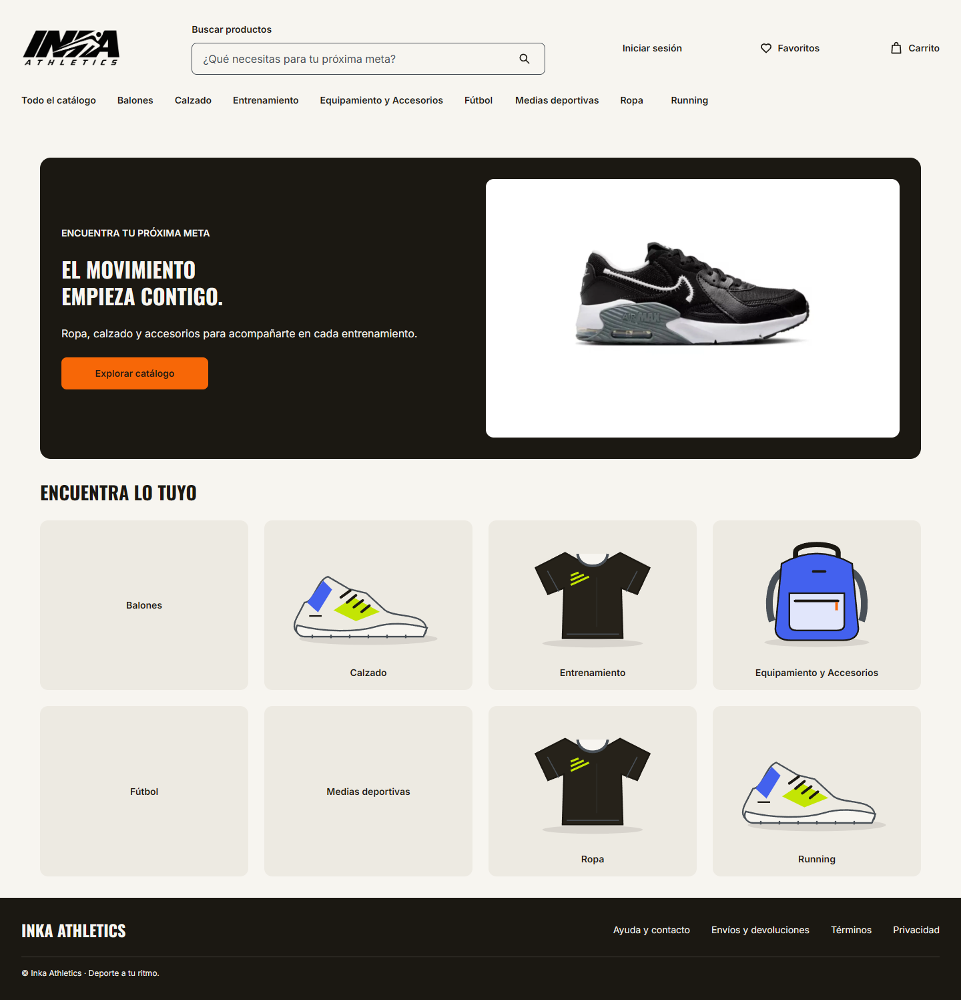
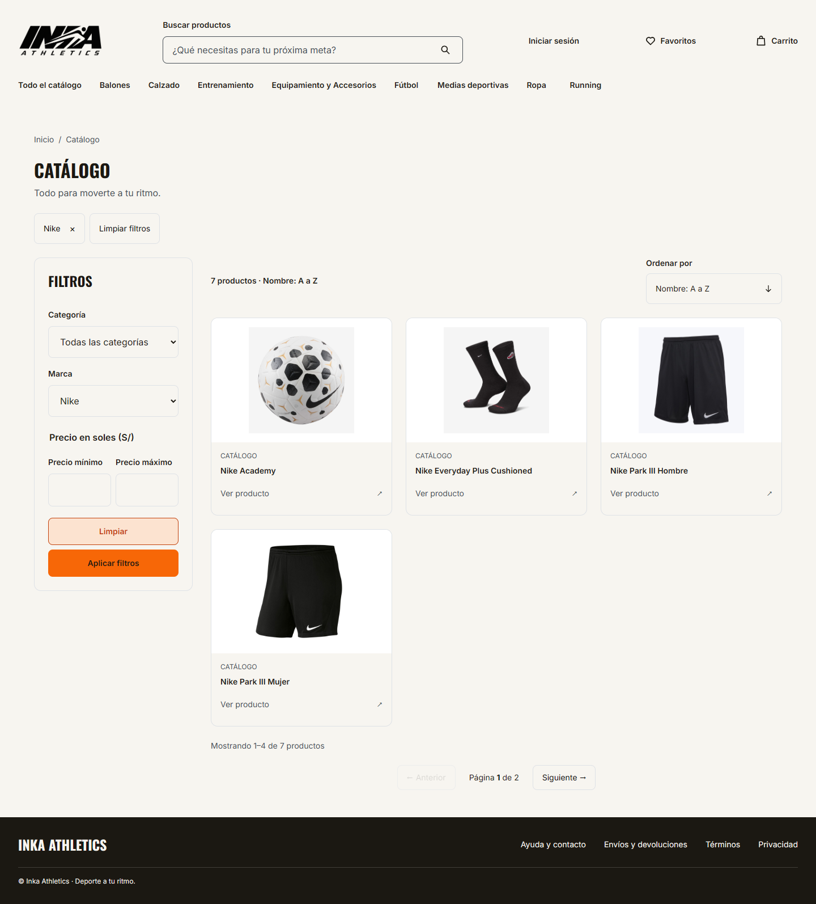
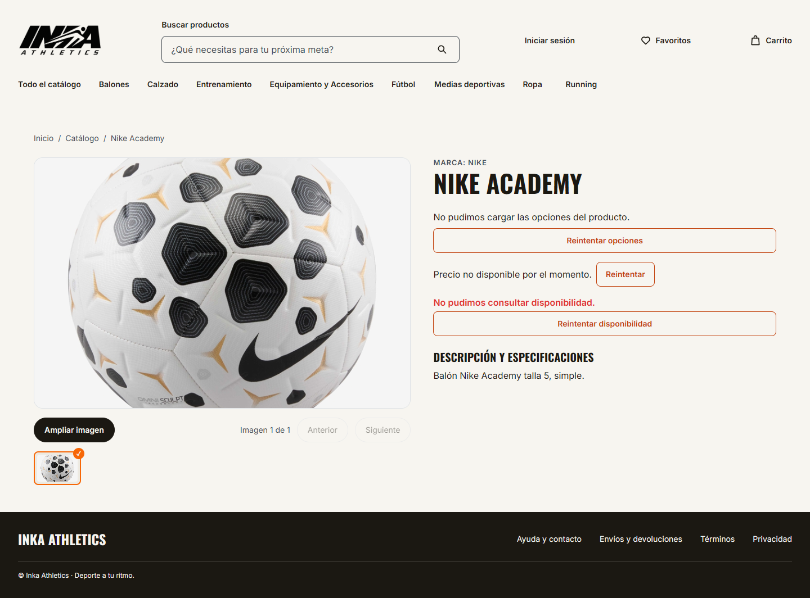
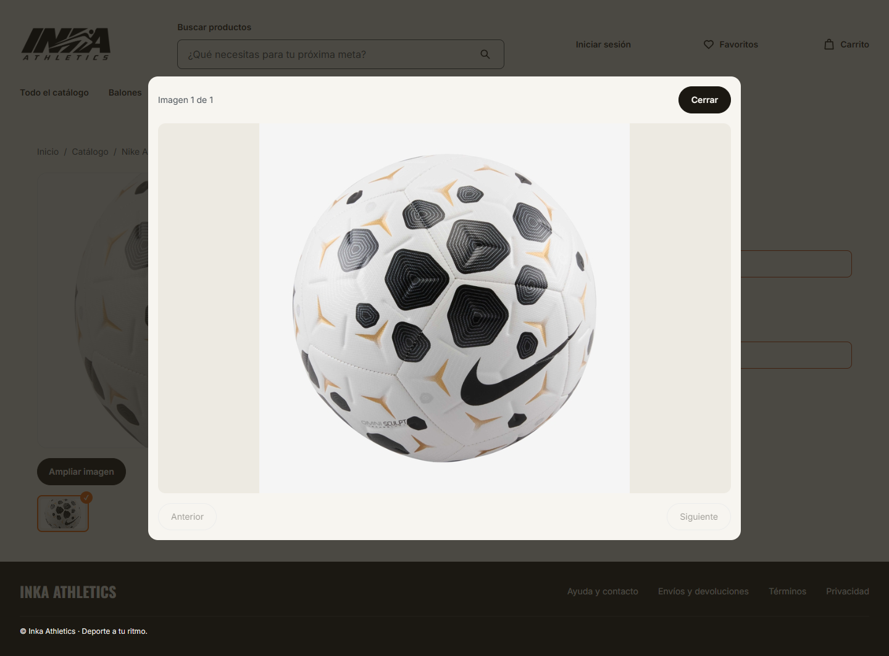

# Demo de frontend REAL contra G6 Azure — 06/11/2026

Capturas obtenidas el **06/11/2026, 10:47:12–10:47:16 Lima**, antes del apagado anunciado a las 13:00. Se ejecutó Microsoft Edge real mediante Playwright, viewport 1440 × 1000, en un demo local: navegador → Next → BFF G1 → Azure. No se interceptaron ni sustituyeron respuestas HTTP.

## Cortes realmente ejecutados

- Backend **develop v1.7.0**, `3ec390c4e4cb77b8699d4e3448966c9f4e13133e`, ya con el adaptador F011 REAL integrado.
- Frontend **develop v1.3.0**, `28f4bb002247c686a742a406c486168e9ad1424c`.
- Clones nuevos, instalación desde lockfile y builds de ambos proyectos PASS.
- Next local: `http://127.0.0.1:3860`; BFF local: puerto 10860.
- Proveedor: `https://g6-po-axl031-167090a.chilecentral.cloudapp.azure.com`.
- `CATALOG_SOURCE=real`, `BFF_MODE=real`, `PRODUCTOS_AUTH_MODE=public-read-only`, token vacío, TLS validado y host exacto de imágenes `slzglmtiyrzygpkiuthf.supabase.co`.
- Backend local `NODE_ENV=test`; Next usa su build optimizado. No se modificaron Render, Vercel ni sus variables.

Este corte de navegador es **posterior al ensayo HTTP de las 00:53** incluido en esta PR. Sus SHAs y alcance se registran por separado: las capturas no se atribuyen a una ejecución del antiguo Backend `34e3e4c`.

## Lo que se comprobó

| Captura | Resultado verificado |
| --- | --- |
| [Home](01-home-real.png) | `/api/catalog/home` 200 REAL; ocho categorías visibles; hero cargado. Destacados desactivados, arreglo vacío. |
| [Filtro Marca: Nike](02-filtro-marca-nike-real.png) | `/api/catalog/filters` 200 REAL con seis marcas; selector habilitado; Nike aplicado mediante la UI; listado 200 REAL, siete productos y cuatro tarjetas en la página. Precios vacíos. |
| [Ficha Nike Academy](03-ficha-nike-academy-real.png) | Handoff tarjeta → ficha; `/api/catalog/products/nike-academy-hv4386-100` 200 REAL; `meta.source=REAL`; nombre, marca, descripción e imagen del producto. Se conserva el retorno al listado con marca Nike. |
| [Galería ampliada](04-ficha-galeria-ampliada-real.png) | Visor abierto desde la ficha con el mismo producto REAL. |

La imagen G6 de tarjeta y galería se decodificó en el navegador con tamaño natural **700 × 700**. No hay rótulo MOCK en Home, catálogo ni ficha. No aparecieron errores JavaScript de página. Las cuatro comprobaciones del recorrido pasaron.

## Limitaciones visibles, conservadas en las capturas

**La ficha F011 REAL no acredita la ficha comercial completa.** En la captura se ven «No pudimos cargar las opciones del producto», «Precio no disponible por el momento» y «No pudimos consultar disponibilidad». Las rutas G1 de variantes, precio y disponibilidad devolvieron **503**; en este corte sus servicios todavía rechazan el modo REAL antes de conectar esos adaptadores. No se atribuyen estos 503 locales a una caída de Azure. No se compró ni agregó nada al carrito.

G6 devuelve las referencias de atributos sin valor textual legible para este producto; la proyección F011 conserva cero especificaciones y muestra la descripción, sin inventar valores a partir de IDs. No se ejercitó el rango de precio en este recorrido. Los dos fallos del filtro de precio del ensayo de las 00:53 mantienen su registro histórico separado.

## Evidencia de red y archivos

- [browser-proof.json](browser-proof.json): fechas, SHAs, URLs del navegador, HTTP, fuente REAL, correlaciones, cantidades, imagen decodificada y alertas visibles.
- [upstream.jsonl](upstream.jsonl): sólo las llamadas BFF → Azure del recorrido final. Todas fueron GET con 200 y correlación preservada, **sin Authorization ni Cookie**. El registro observa el transporte real y no modifica URL, headers ni respuesta.
- [artifact-manifest.json](artifact-manifest.json): tamaño y SHA-256 de las cuatro capturas y el manifiesto del navegador. Las PNG son capturas originales, sin edición.

Para repetir: instalar y construir los dos cortes indicados, configurar únicamente el demo local con el origen Azure y modo público explícito, abrir Home; entrar a `/catalogo?pageSize=4&sort=NAME_ASC`, seleccionar Marca → Nike y aplicar; abrir Nike Academy y ampliar su imagen. El entorno Azure debe seguir encendido. Esta evidencia permanece disponible aunque la VM se apague.

## Home REAL

## Marca Nike aplicada

## Ficha REAL y límites comerciales visibles

## Galería ampliada

