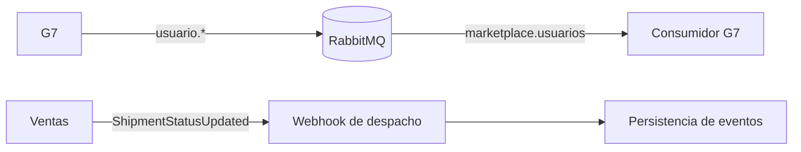

# #321 — Contrato de eventos

Registrar aquí los contratos publicados por G7 (`usuario.*`) y Ventas (`ShipmentStatusUpdated`), junto con ejemplos versionados y runs de productor/consumidor. No completar campos del payload por suposición: enlazar la definición fuente aprobada.

| Productor | Evento / destino observado | Versión / schema | Contrato fuente | Run productor | Run consumidor | Resultado |
|---|---|---|---|---|---|---|
| G7 | Familia indicada para el contrato: `usuario.*`; evento real leído de `marketplace.usuarios` | Pendiente | Comentarios de [BE #313](https://github.com/Taller-SW-Web/G1-Marketplace-Backend/issues/313) y [#294](https://github.com/Taller-SW-Web/G1-Marketplace-Backend/issues/294); enlace exacto al comentario pendiente | Run/permalink pendiente; 25/11 23:07 | Lectura de cola reportada; permalink pendiente | `eventId=5206c121-61e7-4de9-8fe9-0b11306c0daa`, cotejado con outbox; contrato/schema no adjunto |
| Ventas | `ShipmentStatusUpdated`; estados `DESPACHADO` (5) y `ENTREGADO` (2) recibidos por webhook | Pendiente | BE #318; schema/event payload pendiente | Enlace/run pendiente; 26/11 11:05:47–11:05:50 | Persistencia de 7 eventos reportada; permalink pendiente | REAL reportado; token inválido recibió 401; falta adjuntar contrato aprobado |

## Diagrama de publicación y consumo

## Campos de contrato a enlazar

Para cada evento, adjuntar el schema fuente y documentar: nombre y versión, clave de enrutamiento, payload, identificador de evento, `correlation-id`, política de reintento/duplicados y compatibilidad. Los valores y políticas deben salir del contrato aprobado.

| Evento | Tabla de campos / schema | Ejemplos válidos | Compatibilidad / versionado | Responsable |
|---|---|---|---|---|
| Evento G7 de `marketplace.usuarios` (nombre por confirmar) | Pendiente | Pendiente | Pendiente | Pendiente |
| Evento de estado de Ventas (nombre por confirmar) | Pendiente | Pendiente | Pendiente | Pendiente |

La entrega/lectura de un mensaje real acredita el recorrido observado, pero no reemplaza el schema aprobado ni los ejemplos versionados. La evidencia de laboratorio con eventos sintéticos se registra aparte como **LAB LOCAL**.
