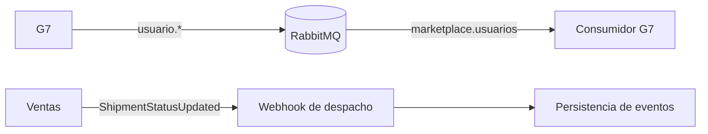
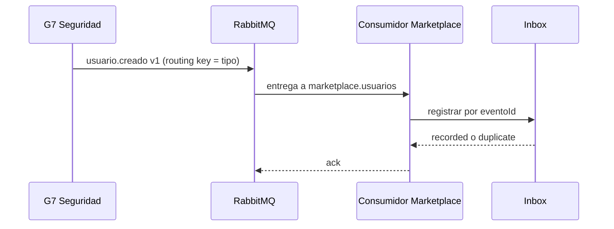

# #321 — Contrato de eventos

Contratos de evento A (G7/RabbitMQ) y B (Ventas/webhook) contrastados con sus acuerdos H-05 aprobados. La entrega REAL se enlaza por separado; aprobación del contrato no equivale a consumo automático verificado.

| Productor | Evento / destino observado | Versión / schema | Contrato fuente | Run productor | Run consumidor | Resultado |
|---|---|---|---|---|---|---|
| G7 | `usuario.creado` v1; routing key `usuario.creado`, binding `usuario.*`, cola `marketplace.usuarios` | Acuerdo G7 v1; payload de `datos` por tipo | [Acuerdo A SPECS #22, commit `addc8fa`](https://github.com/Taller-SW-Web/G1-Marketplace-SPECS/blob/addc8fa20b51e1ed5044e2428511aa176696c246/plan/ACUERDO-RABBITMQ-G7.md) | Publicación/outbox: [BE #313, comentario primario](https://github.com/Taller-SW-Web/G1-Marketplace-Backend/issues/313#issuecomment-7182370357), 25/11 23:07:26 | [BE #314](https://github.com/Taller-SW-Web/G1-Marketplace-Backend/issues/314#issuecomment-7205557701): tres eventos recuperados manualmente desde DLQ; una fila por ID | REAL controlado. El sobre lleva `eventoId` UUID, `tipo`, `version=1`, `fecha` UTC, `usuarioId` y `datos`; deduplica por ID. #409 está fusionada, pero no prueba retry automático REAL post-fix ni `correlationId` |
| Ventas | `ShipmentStatusUpdated` v1.0.0; ruta `POST /api/v1/webhooks/ventas/envios` | Acuerdo H-05 confirmado por G5; campos detallados abajo | [Acuerdo B SPECS #20, commit `e25c08c`](https://github.com/Taller-SW-Web/G1-Marketplace-SPECS/blob/e25c08cbf7235a1cbba68df7d75f2705012e29da/plan/ACUERDO-WEBHOOK-ENVIOS-H05.md) | [BE #318, comentario fuente](https://github.com/Taller-SW-Web/G1-Marketplace-Backend/issues/318#issuecomment-7202913749): 7 eventos 26/11 11:05:47–11:05:50 | Siete filas únicas en inbox (5 `DESPACHADO`, 2 `ENTREGADO`); token erróneo/ausente 401; pedidos de ejemplo `90001`, `90003`, `90005`, `90006` | REAL entre servicios. Los eventos no pertenecen a `PED-2026-00092`; acuerdo especifica reintentos del productor para ciertos fallos, pero no son evidencia de retry observado en esta recepción |

## Diagrama de publicación y consumo



### Secuencia A — G7 → RabbitMQ → consumidor



El acuerdo admite redelivery y exige un único efecto por `eventoId`; el retry automático queda sujeto a la topología/perfil acordado. La recuperación de #314 fue manual desde DLQ y se etiqueta como tal.

### Secuencia B — Ventas → webhook → persistencia

```mermaid
sequenceDiagram
    participant V as Ventas
    participant W as Webhook Marketplace
    participant I as Inbox de despachos
    V->>W: POST /api/v1/webhooks/ventas/envios
    Note over V,W: X-Webhook-Token; eventId único
    W->>I: validar y deduplicar por eventId
    I-->>W: persistido o duplicado
    W-->>V: 2xx confirma; 400/409/422 rechaza; otros errores reintentan según acuerdo
```

## Campos de contrato a enlazar

Para cada evento, adjuntar el schema fuente y documentar: nombre y versión, clave de enrutamiento, payload, identificador de evento, `correlation-id`, política de reintento/duplicados y compatibilidad. Los valores y políticas deben salir del contrato aprobado.

| Evento | Tabla de campos / schema | Ejemplos válidos | Compatibilidad / versionado | Responsable |
|---|---|---|---|---|
| `usuario.creado` v1 | [Acuerdo #22](https://github.com/Taller-SW-Web/G1-Marketplace-SPECS/blob/addc8fa20b51e1ed5044e2428511aa176696c246/plan/ACUERDO-RABBITMQ-G7.md): `eventoId` UUID, `tipo`, `version=1`, `fecha` UTC con milisegundos, `usuarioId`, `datos.roles` | `datos.roles` es lista completa; cuenta cliente de prueba usa `roles:["CLIENTE"]`. Mantener `eventoId` en reintentos; deduplicar; no hay orden global | Acuerdo aprobado; compatibilidad observada en [#314](https://github.com/Taller-SW-Web/G1-Marketplace-Backend/issues/314) | G7 / Marketplace |
| `ShipmentStatusUpdated` v1.0.0 | [Acuerdo #20](https://github.com/Taller-SW-Web/G1-Marketplace-SPECS/blob/e25c08cbf7235a1cbba68df7d75f2705012e29da/plan/ACUERDO-WEBHOOK-ENVIOS-H05.md): `eventId` UUID; `eventType` literal; `version` literal; `timestamp` ISO-8601 con zona; `emitter=modulo-ventas`; `data.orderId`; `data.publicStatus`; `data.trackingNumber` opaco; `data.estimatedDeliveryDate` `AAAA-MM-DD` o `null` | `publicStatus`: `DESPACHADO` o `ENTREGADO`; reprogramación conserva `DESPACHADO` y actualiza ETA. `eventId` es idempotency key. Ventas reintenta cada 5 s hasta 10 intentos para 5xx/401/403/404/timeout/conexión; 400/409/422 son definitivos | Acuerdo confirmado por G5; recepción de 7 ejemplos en [#318](https://github.com/Taller-SW-Web/G1-Marketplace-Backend/issues/318#issuecomment-7202913749) | G5 Ventas / Marketplace |

Los acuerdos SPECS #20/#22 cubren schemas y políticas A/B. #390 (merge `f50938b`) y #409 ya están fusionadas en `develop`; sus pruebas de CI no sustituyen recepción REAL con correlación. La actualización de #314 sigue describiendo recuperación manual de mensajes históricos, no una entrega automática post-fix. Falta enlazar runs del consumidor con IDs de caso y capturar un `correlation-id` no nulo en la entrega REAL de G7. La evidencia de laboratorio con eventos sintéticos se registra aparte como **LAB LOCAL**. El evento de G7 está enlazado a su [comentario fuente](https://github.com/Taller-SW-Web/G1-Marketplace-Backend/issues/313#issuecomment-7182370357); el webhook, a su [registro fuente](https://github.com/Taller-SW-Web/G1-Marketplace-Backend/issues/318#issuecomment-7202913749).
