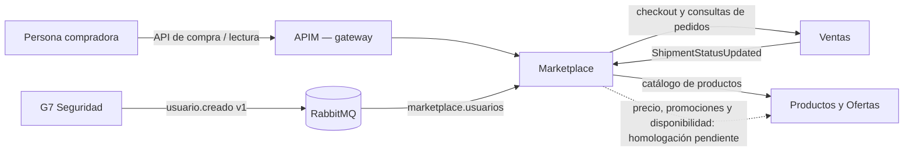
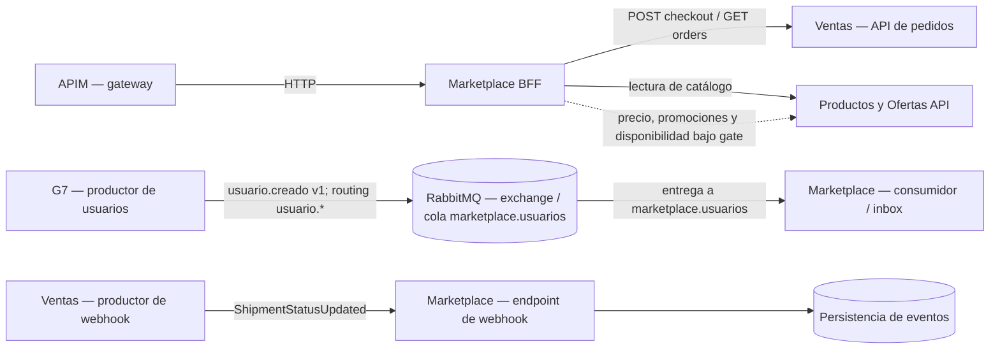
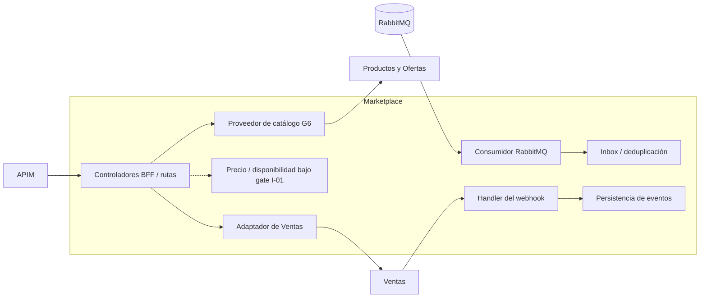
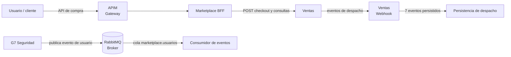

# #325 — Arquitectura C4 de la compra

Vistas de contexto, contenedores y componentes para la arquitectura comunicada: APIM, Marketplace BFF, Productos/Ofertas, RabbitMQ, consumidor de usuarios y webhook de Ventas. Las relaciones marcadas con evidencia enlazan a corridas o reportes; las conexiones de contexto no implican que todos los saltos se hayan medido en una sola traza distribuida.

## Contexto — sistemas y actores

## Contenedores — unidades desplegables observadas

## Componentes — responsabilidades dentro del Marketplace

Los nombres de los componentes internos son descriptivos y se deben contrastar con el código y el despliegue antes de tratarlos como nombres oficiales. Los diagramas muestran las responsabilidades observadas; no aseguran que la compra, el evento de usuario y el webhook compartan un `correlation-id`.

### Vista de recorrido resumida

El diagrama de abajo reúne los saltos con evidencia comunicada; no representa una traza única.

> Confirmado: se han observado BFF→Ventas, G7→RabbitMQ (`marketplace.usuarios`) y Ventas→webhook de despacho. El adaptador de catálogo G6 tiene pruebas HTTP locales; precio/disponibilidad siguen bajo el gate I-01. Estos flujos no corresponden a una sola traza distribuida. Faltan revisión de Arquitectura, identificadores de despliegue/APIM y nombres oficiales de componentes internos. El laboratorio RabbitMQ/PostgreSQL de Leonidas permanece separado y marcado LAB LOCAL.

## Enlaces de evidencia

| Componente / salto | Run / fuente | Reporte | Resultado / límite |
|---|---|---|---|
| Cuenta A → BFF | [Reporte REAL fusionado](https://github.com/Taller-SW-Web/G1-Marketplace-Backend/blob/develop/docs/evidencias/H5/integracion-real/bff/2026-11-26/REAL-2026-11-26T21-00-23.847Z-7f8fc4c5.md) | [Índice de integración REAL](https://github.com/Taller-SW-Web/G1-Marketplace-Backend/tree/develop/docs/evidencias/H5/integracion-real) | 19/19 OK, 0 fallos, sin 429; 26/11 16:00:23–16:00:32; alta de cuenta y rama MFA omitidas |
| BFF → Ventas (crear/leer pedido) | [Informe de compra REAL](https://github.com/Taller-SW-Web/G1-Marketplace-Backend/blob/develop/docs/evidencias/H5/integracion-real/compra/2026-11-26/REAL-2026-11-26T20-05-16.062Z-6afb7c7c.md); `requestId` en [trazabilidad](299-trazabilidad.md) | [Índice de integración REAL](https://github.com/Taller-SW-Web/G1-Marketplace-Backend/tree/develop/docs/evidencias/H5/integracion-real) | Pedido creado/consultado y `PAGADO`; POST 202 y GETs 200; SHA BFF `f17896d`; cotización y revalidación son MOCK |
| G7 → RabbitMQ `marketplace.usuarios` | [BE #313, comentario fuente](https://github.com/Taller-SW-Web/G1-Marketplace-Backend/issues/313#issuecomment-7182370357) / [acuerdo A SPECS #22](https://github.com/Taller-SW-Web/G1-Marketplace-SPECS/pull/22) | Outbox y lectura de evento `usuario.creado` v1 | Evento REAL cotejado con outbox; binding `usuario.*`; no se aportó `correlationId` |
| RabbitMQ → consumidor G7 / inbox | [BE #314, recuperación REAL](https://github.com/Taller-SW-Web/G1-Marketplace-Backend/issues/314#issuecomment-7205557701); [BE #315](https://github.com/Taller-SW-Web/G1-Marketplace-Backend/issues/315) | Consulta PostgreSQL de solo lectura reportada | Se recuperaron manualmente tres eventos originales desde DLQ con parser candidato; no se probó una nueva entrega automática post-fix |
| Ventas → webhook de despacho | [BE #318, comentario fuente](https://github.com/Taller-SW-Web/G1-Marketplace-Backend/issues/318#issuecomment-7202913749) | Registro primario de webhook | 7 eventIds únicos; 5 `DESPACHADO`, 2 `ENTREGADO`; token ausente/incorrecto 401; son pedidos 90001/90003/90005/90006, no `PED-2026-00092` |
| Webhook/evento → correo C-002 | [BE #162, comentario fuente](https://github.com/Taller-SW-Web/G1-Marketplace-Backend/issues/162#issuecomment-7204545580) | Registro de replay | `PED-2026-90001`; mismo eventId marcado `duplicate:true`; un correo enviado |
| LAB LOCAL RabbitMQ + PostgreSQL | [BE #317, comentario fuente](https://github.com/Taller-SW-Web/G1-Marketplace-Backend/issues/317#issuecomment-7203197884) | Nombre de documento citado: `H5-evidencia-consumidor-Leonidas.md`; no se localizó URL canónica del archivo | RabbitMQ 4.1 y PostgreSQL 16 desechables; eventos sintéticos, duplicado/reconexión y ensayo retry/DLQ; no es integración REAL |

## Datos para la vista C4

| Nivel | Artefacto | Identificadores verificados | Revisión pendiente |
|---|---|---|---|
| Contexto | Persona, APIM, Marketplace, G6, G7, RabbitMQ y Ventas | APIM `apim-g1-marketplace-20`; gateway `https://apim-g1-marketplace-20.azure-api.net`; API `marketplace-api`, suffix `v1` | Arquitectura debe confirmar que estos nombres/entorno son los vigentes para el corte |
| Contenedores | APIM, BFF, API G6, productor G7, RabbitMQ, consumidor/inbox, API Ventas y webhook | Render `g1-marketplace-backend`, `https://g1-marketplace-backend.onrender.com`, DB `marketplace-db`; deployment `dep-dc49m1uq1p3s73db96bg` a SHA `f17896d7ee24876ffd33db1bb7dd91d65623ed37`; RabbitMQ exchange `seguridad.usuarios`, queue `marketplace.usuarios`, binding `usuario.*`, DLX `seguridad.usuarios.dlx`, DLQ `seguridad.usuarios.dlq` | Confirmar que el deployment observado representa el corte y obtener confirmación de Arquitectura |
| Componentes | Rutas BFF, catálogo, adaptador de Ventas, consumidor, inbox, handler webhook y persistencia | Código: `SecurityUserEventConsumerService`, `SecurityUserEventInboxService`, `ShipmentWebhookController`, `ShipmentWebhookService`, `PrismaShipmentEventSink`, `CatalogController`, `ProductDetailController`, `ProductPriceController`, `ProductAvailabilityController`, `G5SalesProvider`, `MarketplaceGateway`. Webhook: `POST /api/v1/webhooks/ventas/envios`. APIM reescribe `/v1/{ruta}` → `/api/v1/{ruta}`. | Los nombres se cotejaron con código; Arquitectura debe confirmar límites y relaciones del modelo |

Las tres vistas C4 ya están en el paquete y los identificadores de APIM, Render, RabbitMQ y componentes se cotejaron con configuración/código. Para cerrar #325 falta la revisión de Arquitectura y su confirmación de que esos identificadores corresponden al corte; no se afirma una traza única que conecte todos los saltos.
