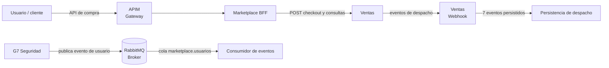

# #325 — Arquitectura C4 de la compra

Diagrama de trabajo actualizado con los recorridos que ya tienen evidencia comunicada. APIM, RabbitMQ y webhook aparecen; faltan nombres/URLs desplegados y vistas C4 formales de contexto, contenedores y componentes.

> Confirmado: las pruebas informadas ejercitaron BFF→Ventas, G7→RabbitMQ (`marketplace.usuarios`) y Ventas→webhook de despacho. No se afirma que estos flujos correspondan a una misma traza distribuida. Confirmar el rol de Productos en el flujo de compra, el nombre del consumidor/webhook y los límites de confianza antes de congelar. El laboratorio RabbitMQ/PostgreSQL de Leonidas permanece separado y marcado LAB LOCAL.

## Enlaces de evidencia

| Componente / salto | Run / fuente | Reporte | Resultado / límite |
|---|---|---|---|
| Cuenta A → BFF | [Reporte REAL fusionado](https://github.com/Taller-SW-Web/G1-Marketplace-Backend/blob/develop/docs/evidencias/H5/integracion-real/bff/2026-11-26/REAL-2026-11-26T21-00-23.847Z-7f8fc4c5.md) | [Índice de integración REAL](https://github.com/Taller-SW-Web/G1-Marketplace-Backend/tree/develop/docs/evidencias/H5/integracion-real) | 19/19 OK, 0 fallos, sin 429; 26/11 16:00:23–16:00:32; alta de cuenta y rama MFA omitidas |
| BFF → Ventas (crear/leer pedido) | [Informe de compra REAL](https://github.com/Taller-SW-Web/G1-Marketplace-Backend/blob/develop/docs/evidencias/H5/integracion-real/compra/2026-11-26/REAL-2026-11-26T20-05-16.062Z-6afb7c7c.md); `requestId` en [trazabilidad](299-trazabilidad.md) | [Índice de integración REAL](https://github.com/Taller-SW-Web/G1-Marketplace-Backend/tree/develop/docs/evidencias/H5/integracion-real) | Pedido creado/consultado y `PAGADO`; POST 202 y GETs 200; SHA BFF `f17896d`; cotización y revalidación son MOCK |
| G7 → RabbitMQ `marketplace.usuarios` | [BE #313](https://github.com/Taller-SW-Web/G1-Marketplace-Backend/issues/313) / [acuerdo A SPECS #22](https://github.com/Taller-SW-Web/G1-Marketplace-SPECS/pull/22) | Outbox y lectura de evento `usuario.creado` v1 | Evento REAL cotejado con outbox; binding observado `usuario.*` |
| RabbitMQ → consumidor G7 / inbox | [BE #314, recuperación REAL](https://github.com/Taller-SW-Web/G1-Marketplace-Backend/issues/314#issuecomment-7205557701); [BE #315](https://github.com/Taller-SW-Web/G1-Marketplace-Backend/issues/315) | Consulta PostgreSQL de solo lectura reportada | Se recuperaron manualmente tres eventos originales desde DLQ con parser candidato; no se probó una nueva entrega automática post-fix |
| Ventas → webhook de despacho | [BE #318](https://github.com/Taller-SW-Web/G1-Marketplace-Backend/issues/318) | Run/log primario pendiente | 7 eventos persistidos; 5 `DESPACHADO`, 2 `ENTREGADO`; token incorrecto 401 |
| Webhook/evento → correo C-002 | [BE #162](https://github.com/Taller-SW-Web/G1-Marketplace-Backend/issues/162) | Run/log primario pendiente | Reenvío de mismo eventId marcado duplicate; un correo enviado |
| LAB LOCAL RabbitMQ + PostgreSQL | `H5-evidencia-consumidor-Leonidas.md`; enlace exacto pendiente | Reporte lab; URL pendiente | RabbitMQ 4.1, PostgreSQL 16 desechables; eventos sintéticos, duplicado/reconexión y ensayo retry/DLQ; no es integración REAL |

## Datos para la vista C4

| Nivel | Artefacto | Enlace |
|---|---|---|
| Contexto | Actores y sistemas externos | Pendiente |
| Contenedores | APIM, BFF, servicios, RabbitMQ, consumidor y Ventas | Pendiente |
| Componentes | Configuración interna relevante para el flujo | Pendiente |

El diagrama y las filas anteriores avanzan el inventario de componentes; la evidencia todavía no contiene identificadores de despliegue/APIM, configuración desplegada, C4 validado por arquitectura ni una traza única que conecte los saltos.
