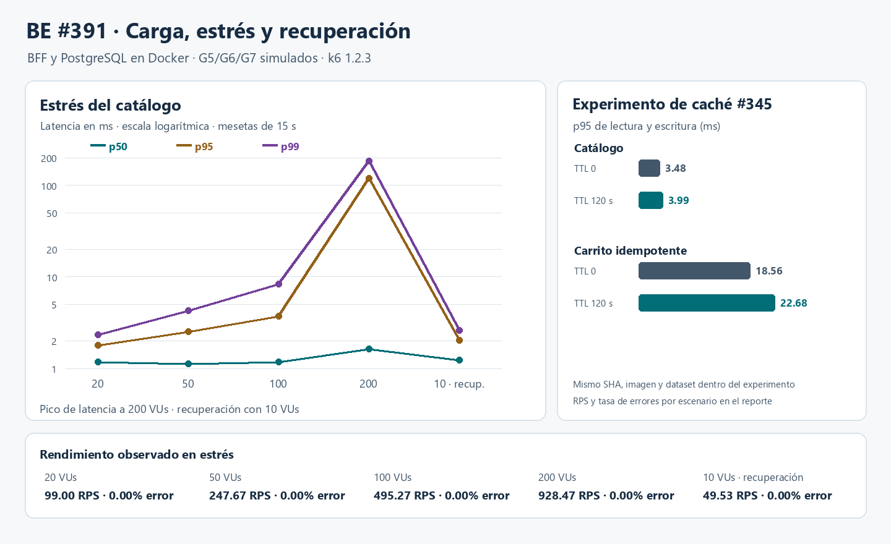

# BE #391 · Carga, estrés y comparación local

La [segunda ejecución documentada](./reporte-final.md) incluye el criterio de quiebre, G6 con latencia simulada, spike, soak y un comando para reproducir el reporte. Esa es la evidencia ampliada para [#391](https://github.com/Taller-SW-Web/G1-Marketplace-Backend/issues/391) y [#306](https://github.com/Taller-SW-Web/G1-Marketplace-Backend/issues/306).

## Primera ejecución · referencia sin latencia simulada

Ejecución del 26/11/2026, hora de Lima. Evidencia para [BE #391](https://github.com/Taller-SW-Web/G1-Marketplace-Backend/issues/391). Los [datos de k6 y muestras de Docker](./datos.json) incluyen el SHA, imagen, hora UTC, métricas y código de salida de cada corrida.

## Resultados

La base fue `develop` en `64670d358fab0c8349ba92de853536f373d5c94a`. Ambas pruebas de carga cumplieron los umbrales. En el estrés del catálogo se observó degradación en la meseta de 200 VUs, seguida de recuperación al reducir a 10 VUs.



### Carga y comparación antes/después

| Versión o condición | Escenario | VUs | Iteraciones | p50 ms | p95 ms | p99 ms | RPS medidos | Error HTTP |
| --- | --- | ---: | ---: | ---: | ---: | ---: | ---: | ---: |
| Base `64670d3` | Catálogo | 10 | 1 488 | 1,55 | 3,53 | 6,22 | 49,29 | 0 % |
| Base `64670d3` | Carrito idempotente | 10 | 1 268 | 9,21 | 22,48 | 43,53 | 84,36 | 0 % |
| Antes · `025efef` · TTL 0 | Catálogo | 10 | 1 490 | 1,50 | 3,48 | 7,03 | 49,38 | 0 % |
| Después · `025efef` · TTL 120 s | Catálogo | 10 | 1 490 | 1,52 | 3,99 | 5,99 | 49,38 | 0 % |
| Antes · `025efef` · TTL 0 | Carrito idempotente | 10 | 1 297 | 7,66 | 18,56 | 26,42 | 85,96 | 0 % |
| Después · `025efef` · TTL 120 s | Carrito idempotente | 10 | 1 276 | 8,96 | 22,68 | 40,01 | 84,40 | 0 % |

- **Catálogo.** El A/B usa la misma imagen de #345 en ambas condiciones. La respuesta de 174 bytes tuvo el mismo SHA-256 y conservó `Cache-Control: no-store`. El p99 bajó de 7,03 a 5,99 ms y el p95 subió de 3,48 a 3,99 ms. Con este par de corridas y RPS iguales, el resultado es insuficiente para recomendar habilitar el TTL.
- **Carrito.** La carga base completó 1 268 eliminaciones y 1 268 reentregas, todas con la respuesta y versión esperadas. El carrito se midió también como control en el A/B. La caché evaluada actúa sobre el catálogo. La variación del carrito se registra como variabilidad entre corridas.

### Estrés y recuperación del catálogo en la base

| Meseta | Duración | Solicitudes | p50 ms | p95 ms | p99 ms | RPS | Error HTTP |
| --- | ---: | ---: | ---: | ---: | ---: | ---: | ---: |
| 20 VUs | 15 s | 1 485 | 1,18 | 1,78 | 2,34 | 99,00 | 0 % |
| 50 VUs | 15 s | 3 715 | 1,13 | 2,52 | 4,25 | 247,67 | 0 % |
| 100 VUs | 15 s | 7 429 | 1,17 | 3,71 | 8,28 | 495,27 | 0 % |
| 200 VUs | 15 s | 13 927 | 1,62 | 118,69 | 183,49 | 928,47 | 0 % |
| Recuperación, 10 VUs | 15 s | 743 | 1,23 | 2,02 | 2,61 | 49,53 | 0 % |

Con 200 VUs subieron p95 y p99. El RPS creció menos que la concurrencia respecto a 100 VUs. En recuperación el p95 bajó a 2,02 ms. La corrida completa incluyó rampas, llegó a 200 VUs y registró 36 326 iteraciones y 36 521 solicitudes con 0 % de errores HTTP.

### Picos de recursos

| Corrida | CPU BFF | Memoria BFF | CPU PostgreSQL | Memoria PostgreSQL |
| --- | ---: | ---: | ---: | ---: |
| Base catálogo | 19,95 % | 73,94 MiB | 4,89 % | 100,00 MiB |
| Base carrito | 81,50 % | 78,45 MiB | 32,25 % | 122,10 MiB |
| Base estrés | 131,08 % | 89,96 MiB | 4,78 % | 125,30 MiB |
| Catálogo · TTL 0 | 15,50 % | 73,03 MiB | 5,29 % | 74,05 MiB |
| Catálogo · TTL 120 s | 21,49 % | 72,47 MiB | 4,03 % | 71,36 MiB |
| Carrito · TTL 0 | 78,73 % | 77,12 MiB | 37,56 % | 97,20 MiB |
| Carrito · TTL 120 s | 81,83 % | 76,61 MiB | 23,75 % | 96,91 MiB |

**Decisión para la exposición.** Presentar la evidencia de #391 como medición local de G1 con terceros simulados. Mantener TTL 0 con el resultado actual. La aceptación del comparativo local como evidencia de [BE #306](https://github.com/Taller-SW-Web/G1-Marketplace-Backend/issues/306) queda a revisión de Jim.

## Entorno y dataset

- Docker Desktop con 8 CPUs disponibles. BFF con límite de 2 CPUs y 768 MiB, PostgreSQL 16 con 2 CPUs y 512 MiB, y k6 1.2.3 con 2 CPUs y 384 MiB.
- BFF y PostgreSQL del Compose de G1. Red interna de Docker, sin puertos publicados. k6 y el emisor G7 simulado usan loopback del BFF. G5 y G6 se simulan mediante las configuraciones mock/fixture. El proyecto usa PostgreSQL en `tmpfs` y no incorpora el `.env` de trabajo.
- Catálogo con fixtures del commit probado y `GET /api/v1/catalog/home` como lectura fija. La escritura es `DELETE /api/v1/carts/current/items/INKA-RUNNER-42`, con una sesión sintética por VU.
- En cada iteración del carrito se prepara una unidad con POST y se mide la eliminación seguida de su reentrega. Las dos respuestas deben ser HTTP 204 y la segunda debe conservar `X-Cart-Version`. Los POST de preparación se cuentan en las peticiones totales del runner y se excluyen de la latencia y RPS de la escritura medida.
- Pausa de 200 ms por iteración. Carga de 10 VUs constantes durante 30 s. Estrés de catálogo con rampas de 5 s y mesetas de 15 s a 20, 50, 100 y 200 VUs, seguido de recuperación a 10 VUs. El RPS por meseta usa su número de pedidos dividido por 15 s.
- Umbrales de carga `p95 < 500 ms`, tasa de errores HTTP menor de 1 % y comprobaciones esperadas superiores a 99 %. Se observaron CPU y memoria de BFF y PostgreSQL durante las corridas. Un valor Docker de 100 % de CPU equivale a un núcleo.

## Reproducir

Ejecutar desde la raíz del Backend con Docker Desktop y PowerShell.

```powershell
$compose = @('-f','compose.h3.yaml','-f','compose.h5.perf.yaml')
docker compose @compose pull k6
docker compose @compose up -d --build --wait postgres backend
pwsh -File scripts/performance/run-h5-391.ps1 -Profile warmup -Workload catalog -OutputDirectory ../be391-runs/warmup
pwsh -File scripts/performance/run-h5-391.ps1 -Profile load -Workload catalog -OutputDirectory ../be391-runs/catalog-load
pwsh -File scripts/performance/run-h5-391.ps1 -Profile load -Workload cart -OutputDirectory ../be391-runs/cart-load
pwsh -File scripts/performance/run-h5-391.ps1 -Profile stress -Workload catalog -OutputDirectory ../be391-runs/catalog-stress
docker compose @compose down
```

Para repetir el experimento de caché, construir la imagen desde el SHA de [BE #345](https://github.com/Taller-SW-Web/G1-Marketplace-Backend/pull/345) `025efef0a4f6aa234fa51f8ba0986c9812ade870`, agregando la etiqueta de imagen `org.opencontainers.image.revision` con ese valor. Configurar `PERF_BACKEND_IMAGE` con la imagen resultante y `PERF_CATALOG_CACHE_TTL_MS` con `0` o `120000`. En cada condición, recrear ambos contenedores con `docker compose @compose up -d --no-build --force-recreate --wait postgres backend` y ejecutar los mismos perfiles de calentamiento y carga en carpetas de resultados distintas.

Para la escritura de #391 se usó el carrito. En la comprobación puntual con el fixture de pedido, agregar al carrito con el bearer simulado devolvió HTTP 500 y el flujo se detuvo antes de cotizar el pedido. El resultado del intento está en `responseChecks.checkout-probe` del archivo de datos.
