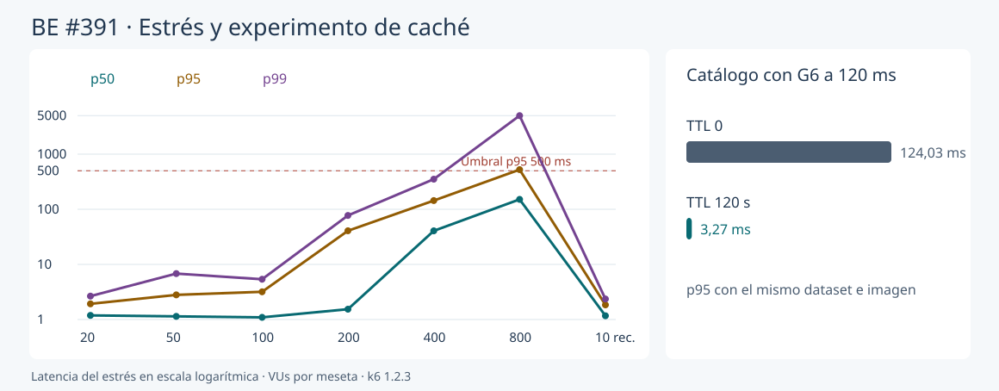

# BE #391 y #306 · Carga, quiebre, recuperación y caché

**Medición local en Docker con terceros simulados (G5/G6/G7). Entorno ajeno a producción.**

Pruebas de G1 con PostgreSQL 16 y k6 1.2.3. El BFF y k6 compartieron loopback dentro de una red interna sin puertos publicados. Los [datos de cada corrida](./datos-finales.json) incluyen SHA, imagen, hora UTC, iteraciones, código de k6 y muestras de recursos.

**Primer quiebre observado con 800 VUs.** p95 de 524,16 ms, 1254,13 RPS y 3,54 % de errores. El p95 bajó a 1,84 ms al volver a 10 VUs, con 0,00 % de errores en recuperación.



## Casos de performance para BE #392

Los cinco casos usan el entorno local aislado descrito arriba. Las dos cargas y el soak pasan con p95 menor que 500 ms y errores HTTP por debajo del 1 %. En estrés, cruzar un umbral forma parte del caso y la recuperación se evalúa al volver a 10 VUs.

| Caso | Precondición y pasos | Resultado esperado | Resultado observado | Estado | Evidencia |
| --- | --- | --- | --- | --- | --- |
| CP-PERF-01 · Carga de catálogo | BFF calentado con catálogo simulado. Consultar `GET /api/v1/catalog/home` con 10 VUs durante 30 s. | HTTP 200 y umbrales de carga cumplidos. | p95 3,68 ms y 0,00 % de errores. | Pasó | [Carga de catálogo](#carga-spike-y-soak) |
| CP-PERF-02 · Carga de carrito idempotente | Carritos y sesiones sintéticas. Ejecutar el DELETE inicial y repetirlo sobre el mismo ítem con 10 VUs durante 30 s. | El replay conserva `X-Cart-Version` y cumple los umbrales de carga. | p95 18,15 ms y 0,00 % de errores. | Pasó | [Carga de carrito](#carga-spike-y-soak) |
| CP-PERF-03 · Estrés hasta el quiebre | Catálogo simulado y BFF calentado. Subir por mesetas hasta cruzar un umbral y volver a 10 VUs. | Identificar el primer quiebre y comprobar la recuperación por debajo de los umbrales. | Quiebre a 800 VUs con p95 de 524,16 ms y 3,54 % de errores. Recuperación con p95 de 1,84 ms y 0,00 % de errores. | Pasó | [Estrés y recuperación](#estrés-del-catálogo) |
| CP-PERF-04 · Spike | Catálogo con carga estable de 10 VUs. Saltar a 200 VUs en un segundo y volver a 10. | Registrar el pico y recuperar los umbrales al volver a 10 VUs. | p95 de 24,94 ms en el pico y 1,87 ms en recuperación. 0,00 % de errores en la corrida. | Pasó | [Mesetas del spike](#carga-spike-y-soak) |
| CP-PERF-05 · Soak | Caché con TTL de 120 s y G6 simulado a 120 ms. Mantener 10 VUs durante 5 minutos. | Completar los cinco minutos con los umbrales de carga cumplidos. | 14830 solicitudes, p95 de 2,98 ms y 0,00 % de errores. | Pasó | [Soak y recursos](#carga-spike-y-soak) |

## Carga, spike y soak

Carga de 10 VUs constantes durante 30 s. El carrito usa una sesión sintética por VU y comprueba que repetir el DELETE conserva `X-Cart-Version`. Sus métricas excluyen el POST que restablece el ítem. El spike sube de 10 a 200 VUs en un segundo y vuelve a 10. El soak dura 5 minutos con 10 VUs, caché a 120 s y G6 simulado a 120 ms.

| Escenario | p50 ms | p95 ms | p99 ms | RPS | Error HTTP | Iteraciones | Resultado |
| --- | ---: | ---: | ---: | ---: | ---: | ---: | --- |
| Carga de catálogo | 1,45 | 3,68 | 6,28 | 49,39 | 0,00 % | 1490 | Pasa umbrales |
| Carga de carrito idempotente | 7,66 | 18,15 | 37,81 | 85,82 | 0,00 % | 1296 | Pasa umbrales |
| Spike completo | 1,18 | 21,50 | 93,96 | 319,02 | 0,00 % | 19263 | Medido |
| Soak de catálogo | 1,37 | 2,98 | 4,63 | 49,42 | 0,00 % | 14830 | Pasa umbrales |

| Meseta del spike, VUs | p50 ms | p95 ms | p99 ms | RPS | Error HTTP |
| --- | ---: | ---: | ---: | ---: | ---: |
| 10 | 1,24 | 1,86 | 2,13 | 49,60 | 0,00 % |
| 200 | 1,19 | 24,94 | 132,40 | 969,13 | 0,00 % |
| 10 (recuperación) | 1,16 | 1,87 | 2,67 | 49,40 | 0,00 % |

## Estrés del catálogo

Criterio de quiebre de Jim por meseta de 15 s. p95 mayor a 500 ms o errores HTTP mayores a 1 %. El runner amplía el límite por corridas de 400, 800 o 1000 VUs y conserva la recuperación. El RPS por meseta es el total de solicitudes de esa meseta dividido por 15 s. La tabla corresponde a la corrida `stress-800`.

| Meseta, VUs | p50 ms | p95 ms | p99 ms | RPS | Error HTTP |
| --- | ---: | ---: | ---: | ---: | ---: |
| 20 | 1,19 | 1,93 | 2,66 | 99,00 | 0,00 % |
| 50 | 1,14 | 2,80 | 6,81 | 247,53 | 0,00 % |
| 100 | 1,10 | 3,18 | 5,38 | 496,00 | 0,00 % |
| 200 | 1,54 | 40,74 | 77,29 | 962,13 | 0,00 % |
| 400 | 40,63 | 143,88 | 351,75 | 1540,67 | 0,00 % |
| 800 | 151,23 | 524,16 | 4999,85 | 1254,13 | 3,54 % |
| 10 (recuperación) | 1,17 | 1,84 | 2,36 | 49,40 | 0,00 % |

## Antes/después de la caché de #345

Se usó la misma imagen, SHA `025efef0a4f6aa234fa51f8ba0986c9812ade870`, calentamiento y dataset en ambas condiciones. El Compose simula 120 ms antes de llamar al proveedor de catálogo para que una lectura de caché pueda evitar esa espera. También configura 120 ms para el stub de Ventas. Los escenarios medidos usan catálogo y carrito, por lo que el resultado de optimización corresponde a G6. Se obtuvo el mismo contenido de 174 bytes y la misma cabecera `Cache-Control: no-store` en ambas condiciones.

| Escenario | p50 ms | p95 ms | p99 ms | RPS | Error HTTP | Iteraciones | Resultado |
| --- | ---: | ---: | ---: | ---: | ---: | ---: | --- |
| Catálogo antes, TTL 0 | 122,30 | 124,03 | 126,09 | 30,93 | 0,00 % | 930 | Pasa umbrales |
| Catálogo después, TTL 120 s | 1,43 | 3,27 | 5,56 | 49,38 | 0,00 % | 1490 | Pasa umbrales |
| Carrito de control antes | 9,60 | 19,18 | 26,67 | 84,60 | 0,00 % | 1277 | Pasa umbrales |
| Carrito de control después | 8,60 | 18,24 | 23,80 | 85,61 | 0,00 % | 1289 | Pasa umbrales |

El p95 del catálogo bajó de 124,03 a 3,27 ms, una reducción de 97,36 % bajo la latencia simulada. La mejora se midió con terceros simulados y TTL aplicado al proceso local.

Base de carga, estrés y spike en `64670d358fab0c8349ba92de853536f373d5c94a`. El carrito es el escenario idempotente de escritura. La optimización se evaluó solo en el candidato publicado en #345.

## CPU y memoria máximas observadas

Docker expresa 100 % de CPU como el uso de un núcleo. Los límites del BFF y PostgreSQL son 2 CPUs cada uno. k6 tiene su propio límite de 2 CPUs.

| Corrida | BFF CPU / RAM | PostgreSQL CPU / RAM | k6 CPU / RAM |
| --- | ---: | ---: | ---: |
| smoke | 15,15 % / 136,30 MiB | 3,84 % / 71,30 MiB | 1,07 % / 12,16 MiB |
| baseline-catalog-load | 14,75 % / 150,60 MiB | 3,73 % / 73,20 MiB | 4,10 % / 17,71 MiB |
| baseline-cart-load | 78,37 % / 149,10 MiB | 37,50 % / 97,84 MiB | 8,34 % / 19,34 MiB |
| stress-400 | 132,66 % / 172,00 MiB | 4,29 % / 101,50 MiB | 78,84 % / 186,80 MiB |
| stress-800 | 127,99 % / 175,10 MiB | 6,90 % / 98,15 MiB | 72,26 % / 358,60 MiB |
| spike | 125,60 % / 154,80 MiB | 3,91 % / 97,14 MiB | 61,80 % / 90,97 MiB |
| cache-off-catalog-load | 15,51 % / 85,11 MiB | 4,13 % / 71,67 MiB | 3,04 % / 16,48 MiB |
| cache-on-catalog-load | 14,64 % / 72,39 MiB | 5,30 % / 71,90 MiB | 4,21 % / 16,95 MiB |
| soak | 18,63 % / 87,76 MiB | 6,01 % / 101,60 MiB | 4,36 % / 20,62 MiB |

## Un comando para reproducir

Desde la raíz del Backend, con Docker, Git, Node y PowerShell 7 instalados, usar un directorio de salida nuevo.

```powershell
pwsh -NoProfile -File scripts/performance/run-h5-391-suite.ps1 -OutputDirectory ../be391-final
```

El runner construye o reutiliza imágenes de SHA conocidos, prueba los perfiles secuencialmente, conserva las salidas originales y genera reporte, gráfico y datos en ese directorio. Usa un proyecto Compose exclusivo y desmonta los contenedores al terminar. Para el smoke de CI, usar el mismo comando con `-SmokeOnly` y un directorio nuevo. Ese modo construye el `HEAD` del checkout de CI y prueba una lectura de catálogo con 1 VU durante 5 s.
